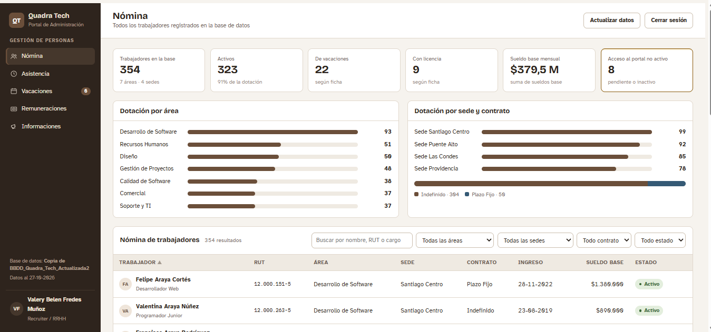
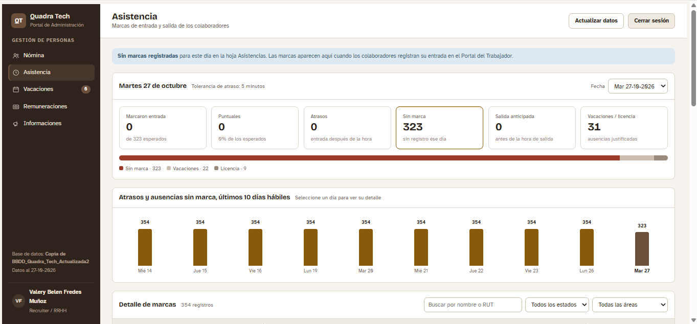
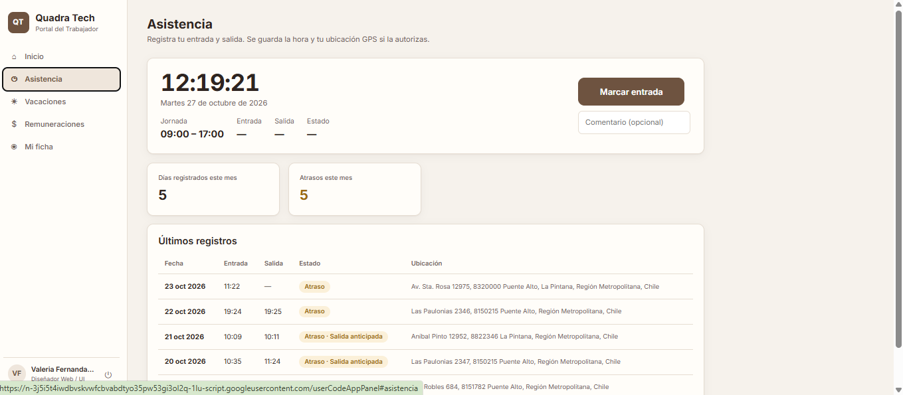
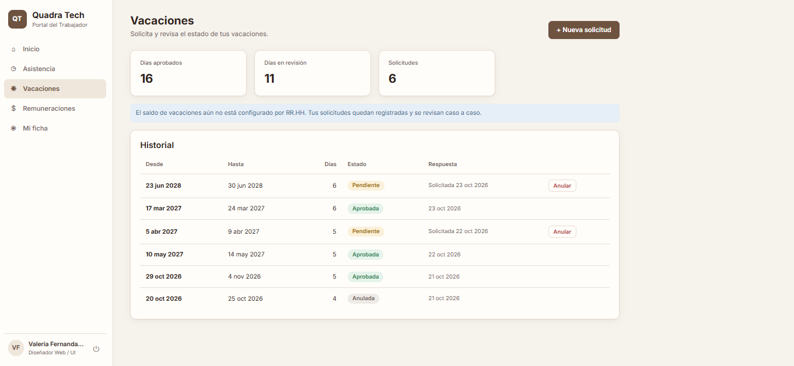
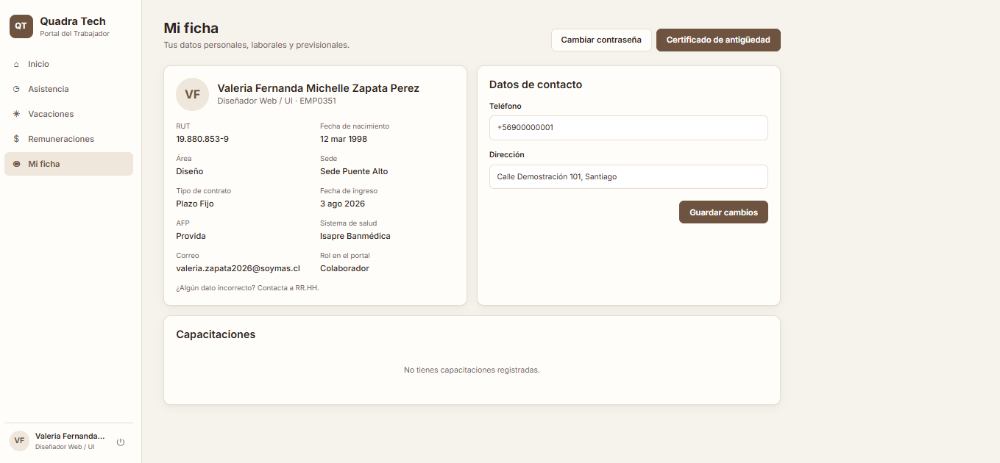

# Portafolio de Análisis de Datos

¡Hola! Soy Valeria Zapata. En este repositorio reúno los ejercicios y proyectos que desarrollé en mis clases de **Análisis de Datos**, usando hojas de cálculo (Excel y Google Sheets) para ordenar información, calcular indicadores y responder preguntas de negocio.

## Herramientas y habilidades
- Google Sheets / Excel
- Fórmulas y funciones
- Cálculo de totales, promedios y porcentajes
- Análisis por categoría y por mes
- Cálculo de IVA y descuentos

## Proyectos

### 1. Análisis de compras anuales (inventario)
Ejercicio de la clase de Análisis de Datos. A partir de un registro de compras, calculé:
- Compra total anual
- Compra total anual por categoría
- Compra total anual por mes
- Compra total anual de la categoría "Electrónica" por cada mes
- Compra total del primer semestre para cada categoría

**Herramientas:** fórmulas en hojas de cálculo.
👉 [Ver hoja de cálculo](https://docs.google.com/spreadsheets/d/1w5dM6KKX2drikDI4d-M4ZRBbD5f9b2wba8qKyEkAHVg/edit?gid=280469266#gid=280469266)

### 2. Análisis de ventas
Ejercicio de la clase de Análisis de Datos. A partir de un registro de ventas, respondí:
- ¿Cuál es el total de ventas (sin IVA)?
- ¿Cuál es el producto con mayor cantidad de ventas totales (sin IVA)?
- ¿Cuál es el promedio de descuento aplicado en las ventas?
- ¿Cuánto IVA ha recaudado la empresa en total?
- ¿Cuál es el mes de mayor venta total (con IVA)?

**Herramientas:** fórmulas en hojas de cálculo.
👉 [Ver hoja de cálculo](https://docs.google.com/spreadsheets/d/1F5VSaec-53Tl77TLqG97XknFt0GVnJ8lSY_DQqutx98/edit?usp=sharing)

### 3. Quadra Tech: plataforma de gestión de personas (RR. HH.)
Proyecto grupal de cierre de año, presentado en una expo, desarrollado por **Carla Migone, Valery Fredes y Valeria Zapata**. Aplicación web hecha con **Google Apps Script** que reúne en un solo lugar trámites de recursos humanos que suelen estar repartidos entre planillas, correos y mensajes.

**Portal de Administración (RR. HH. y jefaturas)**
- Nómina con filtros por área y sede
- Asistencia diaria con atrasos y ubicación GPS
- Gestión de vacaciones y sueldos

**Portal del Trabajador**
- Marca de entrada y salida con un solo botón y GPS
- Solicitud de vacaciones con seguimiento en línea
- Liquidaciones y certificados para descargar

**Mi participación:** colaboré en la creación de la aplicación web y desarrollé la base de datos completa en Google Sheets.

**Herramientas:** Google Apps Script, Google Sheets, HTML/CSS/JavaScript.
*Todos los datos son ficticios.*

#### Capturas de la aplicación

**Inicio**

**Asistencia**

**Marca de asistencia**

**Vacaciones**

**Ficha del empleado**

👉 [Abrir la aplicación](https://script.google.com/macros/s/AKfycbxtnXXmrkgbG3XJPsrDRb9sBlIaQkBLJNwVVvpXfdA9MhwWWNL3zMZ8G5gkox9T9yMECQ/exec)
👉 [Ver la base de datos (hoja de asistencia)](https://docs.google.com/spreadsheets/d/1dBj3Ewhc3CkoFVs1MLGIb0AQ00IuD0gpiY7lx9ZLNI0/edit?usp=sharing)

## Contacto
📧 valeriafernandam98@gmail.com
